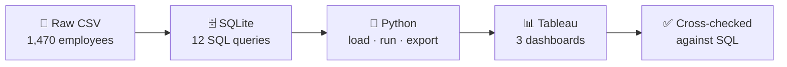

<div align="center">

# 🌿 HR Attrition Analytics

### *Who leaves, why they leave, and what HR can do about it*


**1,470 employees · 237 leavers · 16.12% attrition**

</div>


---

## 👋 Hi there!

This project follows a messy question, *"why are people leaving?"*, all the way to a clean, clickable answer.
It starts with a raw HR spreadsheet, digs through it with **SQL**, and ends with **interactive Tableau dashboards** an HR director could actually use. ✨

---

## 🚀 Open the dashboard in 30 seconds

| Step | What to do |
|:---:|---|
| 1️⃣ | Install the free **[Tableau Public](https://www.tableau.com/products/public/download)** app (Tableau Desktop works too) |
| 2️⃣ | Download **[`hr attrition.twbx`](hr%20attrition.twbx)** from this repo |
| 3️⃣ | Double-click it. That's it! 🎉 |

> 💡 The `.twbx` is a *packaged* workbook: the data lives inside it, so it opens on any computer with no setup or database connection.
>
> 🌐 Prefer the browser? Find it on **[my Tableau Public profile](https://public.tableau.com/app/profile/mayil.huseynov/vizzes)**.

---

## 🗺️ A quick tour

| | Dashboard | What you can do there |
|:---:|---|---|
| 📊 | **Executive Overview** | See the headline KPIs, attrition by department, job role and tenure, a risk heat-map, and the 3 riskiest employee profiles |
| 🔎 | **Segment Explorer** | Play with 5 filters (department, role, overtime, tenure, pay) and watch every number update live |
| ✅ | **SQL Cross-Validation** | Proof that Tableau and SQL agree, number for number |

<table>
  <tr>
    <td></td>
    <td></td>
  </tr>
</table>

---

## 🔍 What the data whispered

> **The short version:** working overtime on low pay early in your tenure is the riskiest combination by far.

| 🕒 Overtime | 🌱 Early tenure | 💸 Pay level |
|:---:|:---:|:---:|
| **30.53%** leave with overtime | **29.82%** leave in their first 2 years | **29.35%** leave in the lowest pay quartile |
| vs **10.44%** without | vs **8.13%** after 11+ years | vs **10.35%** in the highest |

🚨 **The riskiest profile:** overtime + first 2 years + lowest pay quartile, at **71.11% attrition** (32 of 45 people).

*These are associations in a synthetic IBM sample, not proof of cause. See the limitations in [note.md](note.md).*

---

## ⚙️ How it works



- **🗄️ SQL does the thinking.** Every band, quartile, pivot and ranking is computed in SQL.
- **🐍 Python is the stage manager.** It loads the data and runs the queries, with no analysis in pandas.
- **📊 Tableau puts on the show.** It turns the SQL results into dashboards you can click around in.

### 🧩 The 12 queries at a glance

| # | Question it answers | SQL skill on show |
|:---:|---|---|
| Q1–Q2 | Did the data load cleanly? (1,470 rows, 0 missing values) | DDL, data validation |
| Q3 | What do leavers vs stayers look like? | aggregates |
| Q4–Q6 | Which departments, roles and groups leave most? | `GROUP BY`, `HAVING COUNT(*) >= 30` |
| Q7 | Does tenure matter? | `CASE WHEN` bands |
| Q8 | Does pay matter? | `NTILE(4) OVER (...)` |
| Q9–Q10 | How do satisfaction and work-life balance interact with department? | pivots with conditional aggregation |
| Q11 | Which combinations are the riskiest? | `HAVING >= 20`, `RANK() OVER` |
| Q12 | How do leavers and stayers differ on every numeric field? | conditional `AVG` |

> 🧾 Every query in [`queries.sql`](queries.sql) has its **real output pasted underneath it** as a comment, so you can check the results without running anything.

---

## 📁 What's in the box

```
📦 HR-Attrition-Analytics
├── 📊 hr attrition.twbx      ← the Tableau dashboards (open me!)
├── 🗄️ queries.sql            ← all 12 SQL queries + their real outputs
├── 🐍 build db.py            ← loads the CSV into SQLite and validates it
├── 🐍 run queries.py         ← runs every query and exports the results
├── 📂 data/                  ← the original IBM HR dataset
├── 🖼️ screenshots/           ← dashboard previews
└── 📝 note.md                ← methodology, validation and limitations
```

## 🛠️ Run the SQL yourself (optional)

```bash
python "run queries.py"
```

This rebuilds the SQLite database (`hr.db`), runs Q1–Q12 and exports every result to `outputs/`. You only need Python 3, because SQLite is built in. 🙌

---

<div align="center">

### 💚 Thanks for stopping by!

Built with SQL, Python and Tableau · Data: IBM HR Analytics Employee Attrition (Kaggle)

*The original brief asked for Power BI. The same requirements are delivered here in Tableau (mapping in [note.md](note.md)).*

</div>
